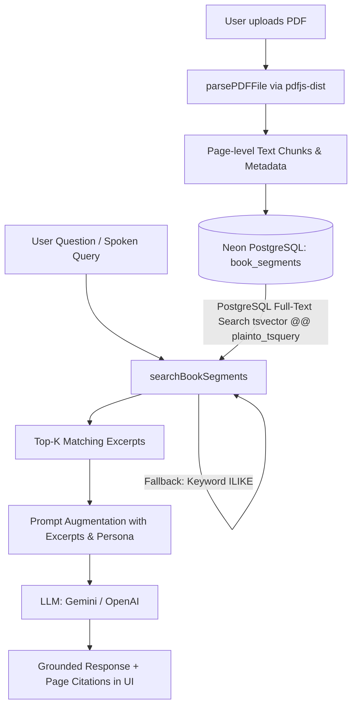

# 📚 Gomakto (Bookified)

An AI-powered interactive reading platform and conversational companion. Upload any PDF book to extract and index its contents, read pages interactively, chat with an AI grounded directly in the book's text via **Retrieval-Augmented Generation (RAG)**, and talk to your book via real-time voice companions.

---

## ✨ Features

- 📖 **Interactive PDF Processing**: Upload PDF books directly in the browser; pages and text are extracted client-side with automatic cover thumbnail generation via `pdfjs-dist`.
- 🔍 **Retrieval-Augmented Generation (RAG)**: Full-text search and keyword matching across indexed book segments to provide strictly grounded answers with exact page citations.
- 💬 **AI Book Chat Assistant**: Converse with an AI companion powered by Google Gemini (`gemini-3.5-flash`) or OpenAI (`gpt-4o-mini`) that cites exact excerpts and page numbers.
- 🎙️ **Voice Companion**: Have natural spoken conversations about any book using either:
  - **Gemini Voice Companion**: 100% free voice interaction using Gemini and browser Web Speech Synthesis.
  - **Vapi AI Integration**: Low-latency, ultra-realistic voice call experience with customizable personas.
- 📑 **In-App PDF Reader**: Read extracted pages sequentially in a dedicated reader tab, with quick actions to query the AI assistant on specific snippets.
- 🎭 **Customizable Personas**: Choose from diverse companion voices and personas (e.g., Rachel, calm, academic) that adapt tone and speaking style.
- 🔐 **Authentication & Multi-Tenancy**: Built-in credential authentication with JWT session cookies and support for Neon Auth JWKS verification.
- 🗄️ **Serverless Database & Storage**: Built on Neon Serverless PostgreSQL with Drizzle ORM, plus S3-compatible cloud storage support.

---

## 🏗️ RAG Architecture



1. **Ingestion & Extraction**: Client-side parsing extracts text page-by-page, recording `pageNumber`, `wordCount`, and sequence index. If page boundaries are missing, a sliding window of 500 words with a 50-word overlap is applied.
2. **Storage**: Chunks are stored in the `book_segments` table in Neon PostgreSQL in 100-row batches.
3. **Retrieval**: When a query is asked, PostgreSQL Full-Text Search (`to_tsvector` and `plainto_tsquery`) performs lexical matching and stemming, falling back to multi-keyword `ILIKE` matching if needed.
4. **Augmentation & Generation**: The top-ranked excerpts are injected into system prompts with strict grounding instructions to eliminate hallucinations.
5. **Citations**: Responses are returned alongside source metadata, rendered as collapsible cards showing original text and page numbers.

---

## 🛠️ Tech Stack

- **Framework**: [Next.js 16 (App Router)](https://nextjs.org/)
- **UI & Styling**: [React 19](https://react.dev/), [Tailwind CSS v4](https://tailwindcss.com/), [Radix UI](https://www.radix-ui.com/), [Lucide React](https://lucide.dev/)
- **Database & ORM**: [Neon Serverless PostgreSQL](https://neon.tech/), [Drizzle ORM](https://orm.drizzle.team/), `drizzle-kit`
- **PDF Extraction**: [`pdfjs-dist`](https://mozilla.github.io/pdf.js/)
- **AI Providers**: Google Gemini API (`@google/genai` / REST API), OpenAI API
- **Voice Services**: [Vapi AI](https://vapi.ai/) & Web Speech API
- **Auth**: `jose` (JWT), `bcryptjs`, Neon Auth JWKS
- **Object Storage**: AWS SDK v3 (`@aws-sdk/client-s3`)

---

## 📁 Project Structure

```text
gomakto/
├── app/
│   ├── (root)/
│   │   ├── book/[slug]/        # Book details, reader view & chat interface
│   │   ├── new/                # PDF upload and book creation page
│   │   ├── sign-in/ & sign-up/ # Authentication pages
│   │   └── page.tsx            # Library homepage with sample and custom books
│   ├── globals.css             # Tailwind CSS & design tokens
│   └── layout.tsx              # Root HTML & metadata layout
├── components/
│   ├── BookCard.tsx            # Book cover card with hover animations
│   ├── BookChat.tsx            # RAG conversation UI with source cards
│   ├── BookReader.tsx          # Page-by-page interactive book reader
│   ├── BookTabsContainer.tsx   # Tab switcher between Reader and AI Chat
│   ├── BookUploadForm.tsx      # PDF dropzone, extraction & submit workflow
│   ├── HeroSection.tsx         # Homepage banner and search controls
│   ├── VoiceCallButton.tsx     # Trigger button for voice companions
│   ├── VoiceCallModal.tsx      # Voice interface for Vapi and Gemini Voice
│   └── ui/                     # Reusable Shadcn / Radix UI primitives
├── db/
│   ├── index.ts                # Drizzle Neon client connection
│   └── schema.ts               # PostgreSQL database schema & relationships
├── drizzle/                    # Generated migration files
├── lib/
│   ├── actions/
│   │   ├── auth.actions.ts     # User registration, login, logout
│   │   ├── book.actions.ts     # CRUD operations, segment storage & search
│   │   ├── chat.actions.ts     # RAG assistant logic with Gemini/OpenAI
│   │   └── voice.actions.ts    # Voice session management & Gemini voice
│   ├── auth.ts                 # JWT verification and Neon Auth handlers
│   ├── constants.ts            # Voice personas, presets, and sample books
│   ├── s3.ts                   # S3 object storage client
│   └── utils.ts                # PDF parser, text chunking, and slug utilities
├── drizzle.config.ts           # Drizzle Kit configuration
├── package.json
└── tsconfig.json
```

---

## 🚀 Getting Started

### Prerequisites

- [Node.js](https://nodejs.org/) (v18 or newer)
- [npm](https://www.npmjs.com/) or [pnpm](https://pnpm.io/)
- A [Neon PostgreSQL](https://neon.tech/) database instance
- (Optional) [Google AI Studio API Key](https://aistudio.google.com/) for Gemini
- (Optional) [Vapi AI Account](https://vapi.ai/) for telephony-grade voice chat

### Installation

1. **Clone repository and navigate to folder:**
   ```bash
   git clone <repo-url>
   cd gomakto
   ```

2. **Install dependencies:**
   ```bash
   npm install
   ```

3. **Configure Environment Variables:**
   Copy the `.env.example` file to create your `.env.local`:
   ```bash
   cp .env.example .env.local
   ```
   Fill in the required credentials (see table below).

4. **Push Database Schema:**
   Deploy the tables directly to your Neon PostgreSQL instance:
   ```bash
   npm run db:push
   ```

5. **Start Development Server:**
   ```bash
   npm run dev
   ```
   Open [http://localhost:4000](http://localhost:4000) in your browser.

---

## 🔑 Environment Variables

| Variable | Description | Required |
| :--- | :--- | :--- |
| `DATABASE_URL` | Neon PostgreSQL pooled connection string | **Yes** |
| `GEMINI_API_KEY` | Google Gemini API key for chat & voice companion | Recommended |
| `OPENAI_API_KEY` | OpenAI API key (fallback provider) | Optional |
| `JWT_SECRET` | Secret key used to sign session JWTs | Recommended |
| `NEXT_PUBLIC_VAPI_PUBLIC_KEY` | Public API key from Vapi Dashboard | Optional |
| `VAPI_PRIVATE_KEY` / `VAPI_API_KEY`| Private key for Vapi assistant sessions | Optional |
| `AWS_ENDPOINT_URL_S3` | S3 endpoint (e.g. Neon Storage or Cloudflare R2) | Optional |
| `AWS_ACCESS_KEY_ID` | Storage access key ID | Optional |
| `AWS_SECRET_ACCESS_KEY` | Storage secret access key | Optional |
| `S3_BUCKET_NAME` | S3 bucket name for uploads | Optional |
| `NEON_AUTH_URL` | Neon Auth OAuth endpoint URL | Optional |
| `NEON_AUTH_JWKS_URL` | JWKS endpoint URL for Neon Auth token validation | Optional |

---

## 🗃️ Database Schema

The database consists of 4 main tables managed through Drizzle ORM:

- **`users`**: Stores user authentication credentials (`name`, `email`, `password_hash`).
- **`books`**: Stores book metadata, author, slug, file pointers, persona, and total segment count.
- **`book_segments`**: Stores individual text chunks, `segment_index`, `page_number`, and `word_count` with indexes for full-text search.
- **`voice_sessions`**: Tracks voice companion calls, duration in seconds, and billing cycle metrics.

---

## 📜 Available Scripts

- `npm run dev`: Runs the Next.js development server on port 4000 (`next dev -p 4000`).
- `npm run build`: Compiles the production build.
- `npm run start`: Starts the production server.
- `npm run lint`: Runs ESLint checks.
- `npm run db:push`: Pushes schema changes directly to Neon PostgreSQL via Drizzle Kit.
- `npm run db:studio`: Opens Drizzle Studio to inspect and manage database records visually.

---

## 📄 License

This project is licensed under the MIT License.
